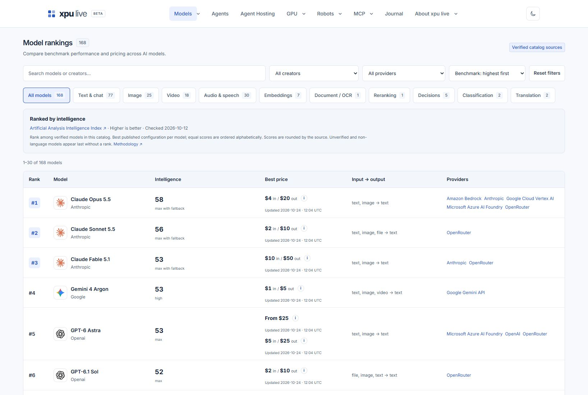
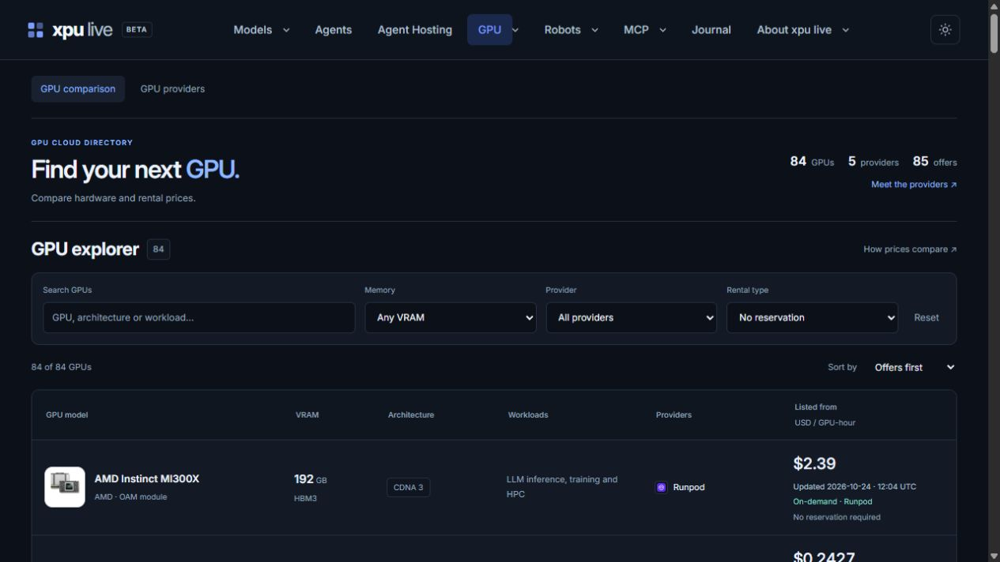
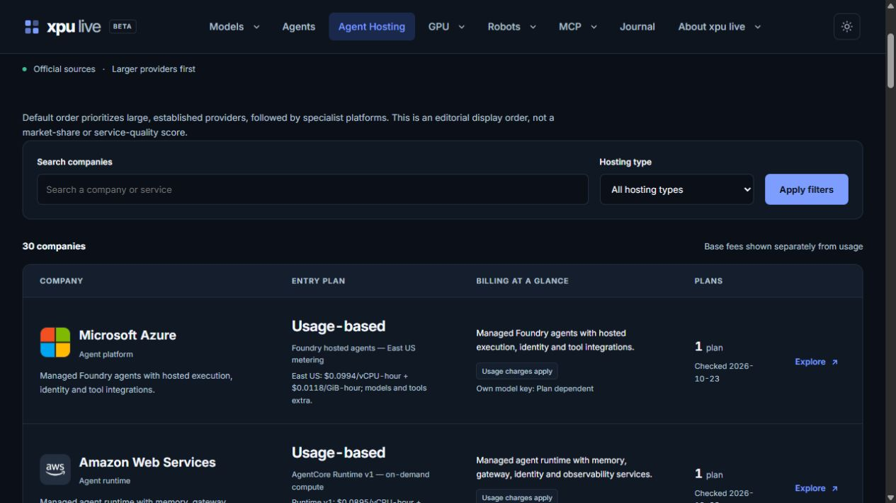

<div align="center">
  <a href="https://xpu.live/">
    
  </a>
  <h1>xpu live</h1>
  <p><strong>A clearer view of AI, compute and robotics.</strong></p>
  <p>Explore models. Compare compute. Discover agents, hosting and robotics.<br>Keep the original sources, pricing conditions and recorded dates in view.</p>
  <p><sub><strong>AI MODELS</strong> &nbsp; · &nbsp; <strong>CLOUD GPUs</strong> &nbsp; · &nbsp; <strong>AGENTS</strong> &nbsp; · &nbsp; <strong>HOSTING</strong> &nbsp; · &nbsp; <strong>ROBOTICS</strong></sub></p>
  <p>
    <a href="https://xpu.live/"><strong>Explore the website →</strong></a> ·
    <a href="https://xpu.live/api-docs/">API</a> ·
    <a href="https://xpu.live/mcp/">MCP</a> ·
    <a href="https://xpu.live/webmcp/">WebMCP</a>
  </p>
</div>

<p align="center">
  <a href="#inside-xpu-live">Screenshots</a> ·
  <a href="#explore-the-catalog">Catalog</a> ·
  <a href="#built-for-people-applications-and-ai-assistants">Integrations</a> ·
  <a href="#compare-with-context">Methodology</a> ·
  <a href="#feedback-and-contact">Feedback</a>
</p>

> [!IMPORTANT]
> **Beta — under active development.** xpu live is currently in beta. Some features or integrations may not work as expected, and data may be incomplete or contain errors. Verify important details against the linked official sources and [report any issues](https://xpu.live/report-error/).

---

## What is xpu live?

[xpu live](https://xpu.live/) helps developers, researchers and teams compare AI models, cloud GPUs, agents, hosting and robotics with the context behind each listing: **published prices, specifications, capabilities, billing conditions, original sources and recorded dates**.

Choosing a model, a hosting platform or a GPU involves more than a headline price. Explore searchable catalogs and published profiles, then use the public interfaces to bring pricing and hosting data into your applications and compatible AI assistants.

**Start where you need it:**

- **Explore:** browse models, providers, agents and robot profiles.
- **Compare:** review GPU rental tariffs and hosting plans alongside their units, conditions and sources.
- **Connect:** use the REST API, remote MCP or supported browser WebMCP tools.

This repository is the product overview and public integration guide for xpu live.

## Inside xpu live

A look at the public catalogs. Select a screenshot to explore the corresponding page.

[](https://xpu.live/)

<table>
  <tr>
    <td width="50%" align="center">
      <a href="https://xpu.live/gpu/"></a><br>
      <strong>Cloud GPU explorer</strong><br>Hardware, rental prices and provider conditions.
    </td>
    <td width="50%" align="center">
      <a href="https://xpu.live/agent-hosting/"></a><br>
      <strong>Agent Hosting</strong><br>Companies, published plans and billing details.
    </td>
  </tr>
</table>

*Actual website views captured on 24 October 2026. Prices, rankings, counts and interface details in these images are snapshots; follow the live website for current information.*

## Explore the catalog

Follow a category to explore its listings, published details and available sources.

| Area | What you can explore |
| --- | --- |
| **[AI models & benchmarks](https://xpu.live/)** | Models across text, image, video and audio; published API rates, capabilities and source-linked benchmark results. |
| **[AI providers](https://xpu.live/providers/)** | Direct APIs, inference providers, cloud platforms and aggregators, with links to their model offerings. |
| **[Cloud GPUs](https://xpu.live/gpu/)** | GPU specifications, rental tariffs, billing units and provider conditions. Browse [GPU providers](https://xpu.live/gpu-providers/) for coverage. |
| **[Agents](https://xpu.live/agents/)** | Agent projects and tools, their interfaces, capabilities, integration details and official project links. |
| **[Agent Hosting](https://xpu.live/agent-hosting/)** | Hosting companies and plans, including base prices, billing, included usage, execution limits, regions, support and official sources. |
| **[Humanoid robots](https://xpu.live/humanoid-robots/)** | Robot profiles, specifications, applications, development stages and price evidence, alongside [manufacturer profiles](https://xpu.live/humanoid-manufacturers/). |
| **[Robot dogs](https://xpu.live/robot-dogs/)** | Quadruped and wheel-legged platforms for research, inspection, education and companionship, with [manufacturer listings](https://xpu.live/robot-dog-manufacturers/). |
| **[Journal](https://xpu.live/journal/)** | Practical guides, pricing analysis, benchmark interpretation and industry reporting. |

## Built for people, applications and AI assistants

Browse on the website, query the public API or connect a compatible assistant. Choose the interface that fits your workflow.

| Interface | Start here | Purpose |
| --- | --- | --- |
| Website | [xpu.live](https://xpu.live/) | Browse, search and compare the public catalogs. |
| REST API | [API documentation](https://xpu.live/api-docs/) · [OpenAPI](https://xpu.live/api/v1/openapi.json) | Query public model/GPU tariff observations and the current Agent Hosting catalog. |
| Remote MCP | [Connection guide](https://xpu.live/mcp/) | Give a compatible assistant structured, read-only access to public pricing and hosting data. |
| Browser WebMCP | [Tool guide](https://xpu.live/webmcp/) | Let a supporting browser agent discover tools on the relevant catalog page. |
| LLM references | [llms.txt](https://xpu.live/llms.txt) · [llms-full.txt](https://xpu.live/llms-full.txt) | Discover the site and read a maintained text reference with catalog and documentation coverage. |

### REST API: make a first request

**Read-only · No API key required**

Make a first request for public model prices, GPU prices or hosting companies:

```bash
# Public AI model tariff observations
curl --fail --silent --show-error \
  'https://xpu.live/api/v1/prices?kind=model&limit=5'

# Public GPU tariff observations
curl --fail --silent --show-error \
  'https://xpu.live/api/v1/prices?kind=gpu&limit=5'

# Current hosting companies, including their published plans
curl --fail --silent --show-error \
  'https://xpu.live/api/v1/hosting/companies?limit=5'
```

<details>
<summary><strong>API reference: endpoints, pagination and response schemas</strong></summary>

Archive endpoints include `/prices`, `/prices/lookup`, `/providers`, `/resources`, `/freshness`, `/last-update` and `/stats` under `https://xpu.live/api/v1/`.

Hosting endpoints include `/hosting/companies`, `/hosting/companies/{company}`, `/hosting/plans`, `/hosting/plans/{id}` and `/hosting/schema`. The schema endpoint describes the complete company and plan parameter dictionary.

Follow `next_offset` when paging. Archive pagination can be pinned with `snapshot_id`; hosting pagination uses `version`. If the dataset changes and the API returns HTTP 409, restart pagination. See the [OpenAPI contract](https://xpu.live/api/v1/openapi.json) for current filters, limits and response schemas.

</details>

### MCP: connect an assistant

Add this remote endpoint to an MCP client that supports Streamable HTTP:

```text
https://xpu.live/mcp-server
```

**Read-only · No API key required**

Start by discovering the available tools in your client.

<details>
<summary><strong>Explore the available MCP tools</strong></summary>

**Model & GPU archive**

- `search_latest_prices`
- `get_latest_price`
- `list_price_providers`
- `get_price_freshness`

**Agent Hosting**

- `search_hosting_companies`
- `get_hosting_company`
- `list_hosting_plans`
- `get_hosting_schema`

</details>

Retain the **source, currency, billing unit, conditions and observation or review date** with the returned data. The [MCP guide](https://xpu.live/mcp/) covers connection and usage.

### WebMCP: work with an open catalog page

Open a supported xpu live directory or profile in a compatible browser and use a WebMCP-capable agent to discover the page's registered tools. Available tools depend on the page: they can read public profiles, search loaded listings, adjust existing browser filters or retrieve pricing data.

Agent Hosting pages also expose tools to search the current company catalog, read company details, list plans and discover parameter definitions. These read the shared hosting API. Catalog records are read-only; supported filter tools change temporary page state.

Browser support and configuration matter. Use the [WebMCP documentation](https://xpu.live/webmcp/) for tool names, page coverage and testing instructions.

### LLM references and automatic hosting updates

- [`llms.txt`](https://xpu.live/llms.txt) provides a concise discovery guide and a maintained hosting index.
- [`llms-full.txt`](https://xpu.live/llms-full.txt) provides an expanded reference, including the complete published Agent Hosting company and plan data.

<details>
<summary><strong>How the public hosting references stay up to date</strong></summary>

Publishing, editing, unpublishing or deleting hosting companies and plans is reflected in subsequent API, MCP and hosting WebMCP reads. The hosting sections of both LLM files refresh automatically, normally within a few minutes. Text references are dated snapshots; use the live interfaces for changes after a build.

</details>

## Compare with context

A useful comparison keeps the evidence, cost conditions and freshness together.

- **Follow the evidence.** Listings link to provider documentation, published pricing, manufacturer information or benchmark sources where available.
- **Keep units and conditions together.** Token prices, GPU-hours, usage charges, subscriptions, commitments and configurations describe different costs.
- **Check freshness.** Archive responses preserve observation timestamps and stale indicators. Hosting offers carry editorial source-check dates. Response or build time is not a new source verification.
- **Keep unknowns visible.** Missing and quote-only prices are not zero. A published zero base fee can still involve usage charges.
- **Confirm before purchasing.** Catalog coverage is selective; availability, final billing and provider terms can change. Model/GPU archive observations, editorial hosting plans and robot price evidence have distinct scopes.

Read the [comparison methodology](https://xpu.live/methodology/), [about page](https://xpu.live/about/) and [commercial policy](https://xpu.live/commercial-policy/) for more detail.

## Feedback and contact

Found an incorrect price, specification or source? Use the [catalog correction form](https://xpu.live/report-error/) and include the listing URL and an authoritative reference.

Have a question or an idea? Get in touch at **[info@xpu.live](mailto:info@xpu.live)**.

---

<p align="center">
  <strong>Find the details. Follow the sources. Compare with context.</strong><br>
  <a href="https://xpu.live/">Explore xpu live →</a> ·
  <a href="#xpu-live">Back to top ↑</a>
</p>

<p align="center">
  <sub>If xpu live is useful to you, consider <a href="https://github.com/xpulive/xpulive">giving this repository a star ⭐</a>.</sub><br>
  <sub>Models · Compute · Agents · Hosting · Robotics</sub>
</p>
